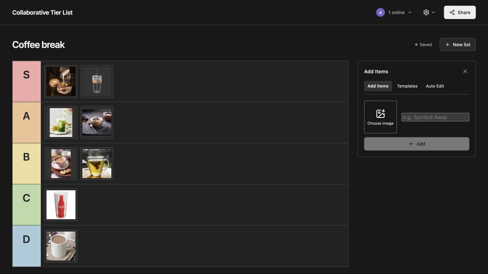

# Collaborative Tier List

Hi! This is my first attempt at using Convex to build an app! I built a collaborative tier list where multiple users can drag and drop items at the same time and also see each others' actions.

**[Try the live app](https://harmless-pigeon-579.convex.site)**




## Run locally

```sh
npm ci
npm run backend
```

Follow the Convex CLI prompts to configure a development deployment, then:

```sh
npm run dev
```

### Cool Features

- **Real-time collaboration:** see other people's cursors and watch items move while they drag and drop.
- **Image search inside the app:** search the web, choose from image results, and crop your pick without leaving the board.
- **Auto Edit:** describe the list you want, then refine it with follow-up prompts. Keep your existing rankings and undo an edit when it won't overwrite someone else's changes.
- **Easy sharing:** send an editable link to collaborate, or uncheck **Allow edits** to share a live view-only version.

### Thoughts on the Platform

I found it surprisingly easy to setup and use. It got the prototype working very quickly. At the same time, there are some friction:

1. Putting API keys in the right places (local, dev, prod) for Convex and Firecrawl annoyoing and require a lot of context switching. I wish ChatGPT + Convex integration could just pop up a dialogue box and I can just put the key in there and it would just put the key in the right place without going through LLM (not sure if that's a thing or not)
2. Presence component (moving cursor around and seeing other user's drag-and-drop) consumes disproportionately large amount of DB bandwidth. In a more "classic" design, presence would be stored in-memory in a stateful server or Redis, which should be more cost efficient.
3. The amount of observability I get out of the box is rather minimal, e.g. no indexing for user-defined logs and metrics. If this goes to prod and start seeing live traffic, I would imagine running into observability issues pretty quickly.
### 
